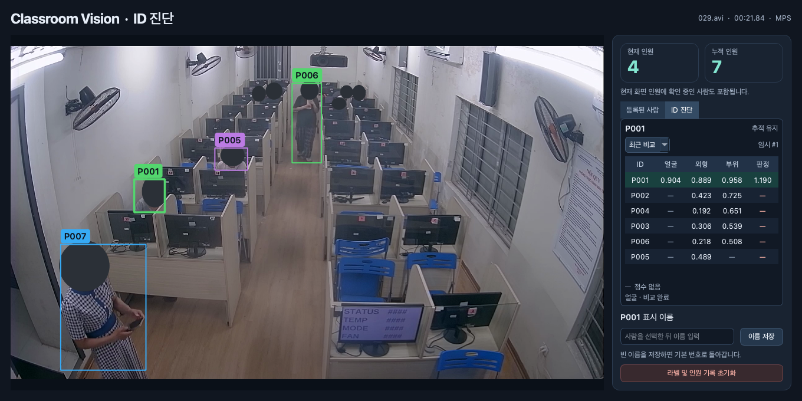

<h1 align="center">Classroom Vision</h1>

<p align="center">
  <strong>2026 한양대학교 ERICA AI+X · 팀 어딜가조</strong><br>
  강의실 학생 수를 실시간으로 집계하고, 출석 확인 후 수업 중 이탈을 확인하는 프로젝트
</p>

<p align="center">
  
</p>

<p align="center"><sub>실제 앱 시연 · 팀 제공 수업 영상 IMG_6463.MOV의 15초 지점. 공개용 화면에서는 얼굴을 가렸습니다.</sub></p>

## 프로젝트 목표

Classroom Vision의 목표는 **강의실에 있는 학생 수를 실시간으로 집계하고, 출석 확인 뒤
수업 중 이탈하는 경우(일명 ‘출튀’)를 확인하는 것**입니다. 학생별 이탈 시각과 복귀 여부를
기록해 잠시 자리를 비웠다가 돌아오는 경우를 구분할 계획입니다.

현재 프로토타입은 카메라에 보이는 인원을 집계하고, 학생이 일어나거나 모니터 뒤에
가려졌다가 다시 보여도 같은 세션 ID로 이어갈 수 있도록 사람 추적과 재식별을 구현했습니다.
이 추적 결과를 바탕으로 오래 화면에 보이지 않는 ID를 표시합니다. 다음 단계에서는 출석·이탈 기록으로 확장할 계획입니다.

후속 단계에서는 **시험 중 부정행위가 의심되는 장면**을 확인할 수 있도록, 화면에 보이는
휴대폰이나 종이 등 소지품과 사용 행동을 분석합니다. 시험 중 휴대폰 화면을 보거나 허용되지
않은 메모(컨닝페이퍼)로 의심되는 자료를 보는 장면을 감독자가 확인할 수 있게 표시할 계획입니다.

## 현재 구현

| 기능 | 구현 내용 |
| --- | --- |
| **사람 탐지와 추적** | 카메라 프레임에서 사람 박스를 만들고 움직임을 이어서 추적합니다. 카메라 움직임도 보정합니다. |
| **세션 ID 재연결** | 외형, 보이는 신체 부위, 품질 기준을 통과한 얼굴 특징을 이전 관측과 비교합니다. 근거가 부족하면 `Checking`으로 표시합니다. |
| **인원 집계와 라벨** | 현재 화면에 잡힌 인원과 세션에 등록된 누적 ID 수를 따로 집계합니다. 번호에 표시 이름을 붙이거나 세션을 초기화할 수 있습니다. |
| **자리 비움 타이머와 경고** | 등록된 ID가 화면에서 사라지면 목록에 미검출 시간을 표시합니다. 기본 60초가 지나면 확인 필요 상태로 바뀌고, 같은 ID가 다시 잡히면 타이머와 경고가 사라집니다. 경고 기준은 조절할 수 있습니다. |
| **ID 진단** | 사람 박스를 선택해 후보별 얼굴·외형·부위 유사도와 판정값을 비교합니다. 얼굴 점수가 비어 있으면 미검출, 크기 부족 등 측정 상태를 보여줍니다. |

## 사용 기술

| 단계 | 기술 | 역할 |
| --- | --- | --- |
| 사람 탐지 | YOLO26n | 영상에서 사람 박스 검출 |
| 연속 추적 | BoT-SORT, ORB | 프레임 간 박스 연결과 카메라 움직임 보정 |
| 외형·부위 비교 | AIM-LTCC, BPBreID | 외형 특징과 공통으로 보이는 신체 부위를 이용한 재식별 |
| 얼굴 비교 | OpenCV, YuNet, SFace | 얼굴 탐지, 품질 검사, 얼굴 특징 비교 |
| 추론과 화면 | Python, PyTorch, PySide6 | MPS·CUDA·CPU에서 추론하고 데스크톱 앱에 추적 결과 표시 |
| 실험 관리 | MLflow (선택 설치) | 실행 설정, 집계 지표, 사용 모델의 출처·해시와 가중치 보관 |

## 설치와 실행

Python 3.11 이상과 카메라를 사용할 수 있는 데스크톱 환경이 필요합니다.
아래 명령은 모두 **프로젝트 루트**에서 실행합니다.

```sh
python3.11 -m venv .venv
.venv/bin/python -m pip install -r person_tracking/requirements.txt
.venv/bin/python person_tracking/person_tracking.py --camera 0
```

카메라 번호는 연결 상태에 따라 다릅니다. `--device auto`는 CUDA, MPS, CPU 순서로
선택하며, 첫 실행 시 모델을 `~/.cache/aix-classroom-tracking/`에 다운로드하고
SHA-256을 검증합니다. 창에서 이름 입력란 밖의 Q 또는 Esc로 종료합니다.
자세한 조작과 ID 연결 방식은 [사람 추적 README](person_tracking/README.md)를 참고하세요.

## MLflow로 실행과 모델 관리

현재 프로젝트는 **사전 학습 모델의 추론 앱**이며 학습·파인튜닝 코드는 없습니다.
MLflow는 카메라 실행 하나를 하나의 **Run**, 여러 실행을 묶는 단위를 **Experiment**로
관리합니다. 학습 loss는 기록하지 않으며, 정확도 지표는 아래의 정답 기반 영상 평가에서 계산합니다.
가중치는 Run의 아티팩트로 관리합니다. Model Registry 등록·배포 및 Registry 모델을
앱으로 불러오는 기능은 포함하지 않습니다.

### 1. 선택 의존성 설치

```sh
.venv/bin/python -m pip install -r person_tracking/requirements-mlflow.txt
```

기존 추적 의존성과 MLflow 3.x를 설치합니다. `--mlflow`를 생략하면 MLflow를
설치하거나 서버를 실행하지 않아도 기존 앱을 그대로 사용할 수 있습니다.

### 2. 로컬 실행 기록과 대시보드

```sh
.venv/bin/python person_tracking/person_tracking.py \
  --camera 0 --mlflow --experiment-name classroom-vision --run-name baseline
```

서버 없이도 프로젝트 루트의 `mlflow.db`(SQLite)에 기록됩니다.
다른 터미널에서 같은 루트 디렉터리의 대시보드를 엽니다.

```sh
.venv/bin/mlflow ui --backend-store-uri sqlite:///mlflow.db --host 127.0.0.1 --port 5000
```

브라우저에서 <http://127.0.0.1:5000>에 접속해 `classroom-vision`을 선택합니다.
Run 여러 개를 선택하고 **Compare**로 설정과 지표를 비교하세요.
예를 들어 `--size 640 --run-name size-640`과 `--size 960 --run-name size-960`을
각각 `--mlflow`와 함께 실행해 처리 시간을 비교할 수 있습니다.
카메라 장면도 달라질 수 있으므로 이것만으로 인식 성능의 우열을 판단하지 마세요.

### 3. 기록되는 정보

| 구분 | 내용 |
| --- | --- |
| Params | 카메라 번호, 실제 실행 장치, 입력 크기, 재식별 간격·배치, 탐지 설정, `identity.*` 매칭 기준 |
| Metrics | 아래 집계 지표를 약 5초마다, 그리고 종료 시 기록. Step은 처리 프레임 누적 수 |
| `models/manifest.json` | 사용한 5개 모델의 파일명, 다운로드 출처, 검증된 SHA-256 |
| `environment.json` | Python, OS, MLflow·PyTorch·Ultralytics·OpenCV 버전 |
| `models/weights/` | `--log-models`를 지정한 경우에만 검증된 가중치 업로드 |

| 지표 | 의미 |
| --- | --- |
| `frames_processed` | Run 전체 처리 프레임 수 |
| `mean_process_ms` / `window_process_ms` | 전체 / 최근 기록 구간의 프레임당 평균 추적 처리 시간(ms). 카메라 대기·화면 렌더링·MLflow 전송 시간 제외 |
| `actual_fps` | 모델 로딩 후 입력 수집 시작부터 마지막 처리 완료까지의 실제 처리 프레임 수 / 벽시계 시간. 카메라 대기·화면 갱신·주기적 로그 전송 지연 포함 |
| `pipeline_frames` / `pipeline_seconds` | 실제 FPS 계산에 사용한 완료 프레임 수 / 경과 시간 |
| `mean_visible_people` | 프레임별 추적 박스 수의 평균. 실제 인원 정답이 아님 |
| `checking_ratio` | 전체 사람 관측 중 ID 미확정 관측의 비율 |
| `reidentified_observations` | `reidentified` 판정을 받은 관측 누적 수. 고유 인원 수가 아님 |
| `face_samples` / `face_feature_ratio` | 얼굴 측정 관측 수 / 그중 얼굴 특징을 얻은 비율. 얼굴 인식 정확도가 아님 |
| `session_identities` / `session_resets` | 현재 세션 등록 ID 수 / 초기화 횟수 |

창의 **라벨 및 인원 기록 초기화**는 같은 Run 안에서 세션만 초기화합니다.
프레임 수와 관측 통계는 Run 전체에 누적됩니다. 정상 종료는 `FINISHED`,
Ctrl+C는 `KILLED`, 실행 중 예외는 `FAILED`로 표시합니다.
강제 종료나 전원 종료 시에는 종료 기록을 남길 수 없어 `RUNNING`으로 남을 수 있습니다.

### 4. 모델 가중치 보관과 다운로드

```sh
.venv/bin/python person_tracking/person_tracking.py \
  --camera 0 --mlflow --run-name baseline-with-weights --log-models
```

기본값은 출처와 해시만 기록합니다. `--log-models`는 큰 가중치를 Run마다 복사하므로
저장 공간과 첫 실행 대기 시간이 늘어납니다. Run의 **Artifacts**에서
`models/weights/`를 확인하고 다운로드할 수 있습니다. CLI로도 받을 수 있습니다.

```sh
.venv/bin/mlflow artifacts download --tracking-uri sqlite:///mlflow.db \
  --run-id <RUN_ID> --artifact-path models/weights --dst-path outputs/downloaded-models
```

`<RUN_ID>`는 실행 시 터미널에 출력되거나 Run 상세 화면에서 확인할 수 있습니다.
모델의 기존 라이선스는 그대로 적용됩니다. 가중치 업로드는 사용 권한이 있는 저장소로만 하세요.

### 5. 팀 공용 서버 연결

공용 MLflow 서버가 있다면 URI를 지정합니다. 별도 옵션 없이 환경변수로도 설정할 수 있습니다.

```sh
export MLFLOW_TRACKING_URI=https://mlflow.example.org
export MLFLOW_EXPERIMENT_NAME=classroom-team
.venv/bin/python person_tracking/person_tracking.py --camera 0 --mlflow --run-name classroom-a
```

주소는 실제 서버 주소로 바꾸세요. 우선순위는 `--tracking-uri` / `--experiment-name`,
환경변수, 기본값 순서입니다. `--run-name`은 생략하면 `camera-tracking`입니다.
`--tracking-uri`, `--experiment-name`, `--run-name`, `--log-models`는 `--mlflow`와 함께 사용합니다.
팀 서버는 운영자가 인증·TLS·접근 권한과 영구 아티팩트 저장소를 구성해야 합니다.
로컬 대시보드를 인증 없이 외부에 공개하지 마세요.

### 저장 위치와 주의 사항

- 로컬 기본 메타데이터는 프로젝트 루트의 `mlflow.db`, 기본 아티팩트는 실행 디렉터리의 `mlruns/`에 저장됩니다. 명령은 루트에서 실행하세요.
- 원격 서버 사용 시 아티팩트 위치와 접근 권한은 서버의 Experiment 설정을 따릅니다.
- DB와 아티팩트 디렉터리는 Git에서 제외합니다. 백업·이동할 때는 둘 다 보관하세요. DB만 복사하면 가중치가 유실될 수 있습니다.
- 영상, 얼굴 이미지·임베딩, 사람별 ID·이름은 MLflow로 전송하지 않습니다. 집계 정보도 민감할 수 있으므로 저장소 접근을 제한하세요.
- 기록은 약 5초 간격의 동기 전송입니다. 원격 서버 지연은 화면을 잠시 멈출 수 있으며, 기록 실패는 실행 오류로 처리합니다. 서버 주소·권한을 확인하거나 `--mlflow` 없이 실행하세요.
- MLflow 연동 검증: `.venv/bin/python -m unittest discover -s person_tracking/tests -v`. 선택 의존성이 없으면 MLflow 테스트만 건너뜁니다.

### 6. 정답 기반 탐지·추적 성능 평가

카메라 실행만으로 정확도는 알 수 없습니다. **프레임별 사람 박스와 동일 인물 ID를
직접 라벨링한 정답**이 있는 영상을 별도 평가해야 합니다.
실제 FPS는 기존 카메라 `--mlflow` 실행에도 기록되며, 나머지 지표는 아래 평가 명령으로 기록합니다.

```sh
.venv/bin/python -m pip install -r person_tracking/requirements-evaluation.txt
.venv/bin/python person_tracking/evaluate_tracking.py \
  --video data/classroom.avi --ground-truth data/gt.txt \
  --mlflow --tracking-uri http://127.0.0.1:5000 \
  --experiment-name classroom-vision --run-name classroom-evaluation
```

위 경로는 예시이며 실제 영상과 라벨로 바꿔야 합니다. 저장소에는 정답 라벨이 포함되어 있지 않습니다.
대시보드의 해당 Run → **Metrics**에서 다음 값을 확인합니다. 비율은 0~1이며 높을수록 좋고,
`id_switches`는 낮을수록 좋습니다. `actual_fps` 단위는 프레임/초입니다.

| 평가 지표 | MLflow 키 | 계산 목적·기준 |
| --- | --- | --- |
| Precision / Recall | `precision` / `recall` | ID 확정 전, 중복 제거 후 사람 탐지 박스와 정답을 IoU 0.5로 일대일 매칭한 정밀도·재현율 |
| IDF1 | `idf1` | 영상 전체의 정답 ID와 확정 세션 ID를 최적으로 대응시킨 Identity F1 |
| ID Switches | `id_switches` | 같은 정답 인물에 대응한 세션 ID 변경 수. TrackEval CLEAR 기준, 가림 후 변경도 포함 |
| HOTA | `hota` | TrackEval HOTA. IoU 0.05~0.95의 19개 기준에서 탐지·연결 정확도를 함께 평가한 평균 |
| Re-ID Accuracy | `reid_accuracy` | 정답상 부재 뒤 첫 복귀 프레임에서 마지막 관측 ID를 되찾은 비율. 아래 문서의 재입장 평가 정의 사용 |
| Actual FPS | `actual_fps` | 입력 디코딩부터 추적·평가 입력 누적·주기적 로깅까지의 실제 처리 속도. 오프라인 평가는 GUI가 없으므로 카메라 모드와 직접 비교하지 않음 |

`Checking`은 탐지 평가에는 포함하지만 확정 ID가 아니므로 IDF1/HOTA에서는 추적 누락으로 처리합니다.
Re-ID 평가 가능한 복귀가 없으면 `reid_accuracy`는 기록하지 않으며, `reid_events=0`과
평가 JSON의 이유를 확인할 수 있습니다. 0%나 100%로 임의 표시하지 않습니다.

집계 결과는 기본 `outputs/evaluation.json`과 Run의 `evaluation/summary.json`에 저장됩니다.
영상과 라벨은 업로드하지 않으며, 재현성 확인용 SHA-256만 기록합니다.
라벨 형식, Re-ID 분모와 FPS 측정 범위는
[사람 추적 README의 평가 안내](person_tracking/README.md#정답-기반-영상-평가)에 정리했습니다.

## 강의실 영상 검증

[AIRC-SMARTCLASS 수업 영상](https://doi.org/10.17632/fw5hs57z78.1) `029.avi`의 첫 30초(25 FPS, 750프레임)를 Apple Silicon MPS에서
처리했습니다. 세 시점에서 원본을 육안으로 센 인원과 화면에 표시된 박스 수를
비교했습니다.

| 시점 | 원본에서 확인한 인원 | 모델이 표시한 사람 박스 |
| --- | ---: | ---: |
| 00:05 | 8명 | 4개 |
| 00:15 | 8명 | 3개 |
| 00:25 | 9명 | 2개 |

왼쪽 앞자리의 `P001`은 세 시점에서 같은 ID로 표시됐습니다. 통로에 있던 한
사람은 추적이 끊긴 뒤 `P004`에서 `P006`으로 바뀌었습니다. 얼굴 측정은 박스
단위로 436회 시도했고, 7회에서 비교 점수가 나왔습니다. 멀거나 모니터에 가려진
사람에게 박스가 빠지는 현상이 인원 집계에 직접 영향을 주었습니다.

## 다음 단계

- 작은 사람 박스와 가림이 많은 자리에서 탐지 누락을 줄입니다.
- 같은 사람에게 새 번호가 붙는 상황을 영상 구간별로 검증합니다.
- 학생별 출석 확인과 이탈·복귀 시각을 기록해 출석 후 이탈을 확인합니다.
- 시험 중 소지품 탐지와 사용 행동 분석을 연결해 감독자가 확인할 장면을 표시합니다.

## 팀 어딜가조

| 이름 | 역할 |
| --- | --- |
| 조영은 | 디자인, PPT 제작, PM |
| 이주은 | 데이터 수집·분석, 발표 |
| 손동열 | 객체 탐지 모델 제작, 시스템 개발 |
| 목정빈 | 발표 기획, PPT 제작 |
| 강슬기 | 데이터 수집·분석 |

## 외부 구성요소

BPBreID의 HRNet 코드에는 [Hippocratic License 3.0](person_tracking/vendor/LICENSE.bpbreid)이
적용됩니다. 출처와 수정 내역은 [BPBreID 안내](person_tracking/vendor/NOTICE.md),
YuNet과 SFace의 출처 및 이용 조건은 [얼굴 모델 안내](person_tracking/vendor/NOTICE.face-models.md)에
정리했습니다.

영상 검증에 사용한 `029.avi`는 Van Anh Nguyen Thi, Tu Chu Pham Dinh, Son Le Hoang의
[AIRC-SMARTCLASS Part 2](https://data.mendeley.com/datasets/fw5hs57z78/1)에 포함돼 있습니다.
데이터셋은 [CC BY 4.0](https://creativecommons.org/licenses/by/4.0/)으로 공개됐습니다.
