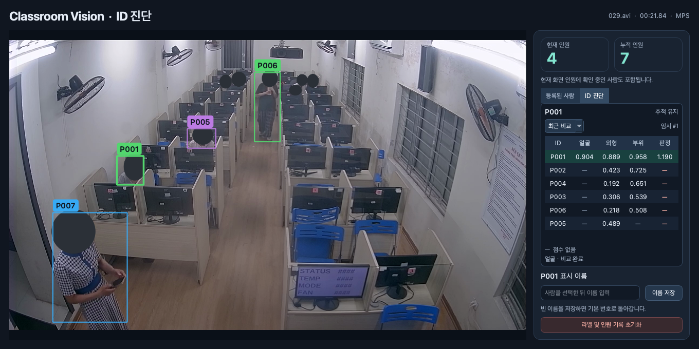

<h1 align="center">Classroom Vision</h1>

<p align="center">
  <strong>교실 상반신 탐지 · 학생 추적 · 인원 집계 · 자리 비움 확인</strong><br>
  2026 한양대학교 ERICA AI+X 공학융합프로젝트 · 팀 어딜가조
</p>

<p align="center">
  <a href="deploy/START.ipynb">시연 노트북</a> ·
  <a href="deploy/README.md">설치와 실행</a> ·
  <a href="fine_tuning/README.md">최종 파인튜닝</a> ·
  <a href="deploy/NOTICE.md">모델·데이터 출처</a>
</p>

<p align="center">
  
</p>
<p align="center"><sub>실제 앱 시연 화면 · 팀 제공 수업 영상 IMG_6463.MOV의 15초 지점 · 공개용 얼굴 가림 처리</sub></p>

## 무엇을 만드는가

강의실 학생 수를 실시간으로 집계하고, 출석 확인 후 수업 중 이탈하는 경우인
**‘출튀’를 확인할 수 있는 시스템**을 개발합니다. 학생이 가려지거나 화면 밖으로
나갔다 돌아오는 상황에서 같은 ID를 연결하고, 보이지 않은 시간을 확인하는 것이
현재 프로토타입의 중심입니다.

현재는 **사람 탐지·추적, 세션 ID, 인원 집계, 자리 비움 타이머와 경고**를 구현했습니다.
학생별 출석 확정·이탈 사유 판단은 후속 과제입니다. 이후에는 휴대폰·메모 등 소지품과
사용 행동을 분석해 시험 중 감독자가 확인할 장면을 표시하는 기능으로 확장합니다.

## 바로 시연하기

1. 저장소를 내려받고 VS Code에서 **[deploy/START.ipynb](deploy/START.ipynb)**를 엽니다.
2. **로컬 Python 3.13 커널**을 선택하고 **전체 실행**을 누릅니다.
3. 외부 실행 준비 창에서 **카메라 이름 또는 영상 파일**을 고른 뒤 **추적 시작**을 누릅니다.

필요한 패키지와 보조 모델은 첫 실행에 준비합니다. **최종 파인튜닝 탐지 가중치가 동봉돼
기본 적용됩니다.** 연산 장치는 CUDA → Mac MPS → CPU 순서로 자동 선택하며 직접 지정할
수도 있습니다. 추적이 시작되면 준비 창은 숨겨지고, 종료하면 다시 나타납니다.
서버 연결 없이 실행하며, 준비를 마친 환경에서는 오프라인 시연이 가능합니다.

설치 조건, Windows·Mac 안내, 카메라 권한, 장치 선택과 문제 해결은
**[배포본 README](deploy/README.md)**에 정리했습니다.

## 현재 구현

| 기능 | 동작 |
| --- | --- |
| **교실 상반신 탐지** | COCO 사전학습 YOLO26n을 교실·상반신 데이터로 파인튜닝해 사람별 박스를 검출합니다. |
| **연속 추적과 ID 연결** | BoT-SORT로 프레임을 연결하고 ORB로 카메라 움직임을 보정합니다. 얼굴·외형·보이는 신체 부위의 특징을 비교해 세션 ID를 연결합니다. |
| **신규 인물 확인** | 머리·어깨와 관측 품질을 확인하고, 근거가 쌓일 때까지 `Checking`으로 표시합니다. |
| **인원 집계·이름 지정** | 현재 관측 인원과 누적 등록 ID 수를 표시하고, 선택한 ID의 이름 지정과 세션 초기화를 지원합니다. |
| **자리 비움 경고** | 등록된 ID가 보이지 않을 때 타이머를 시작하고, 설정한 시간이 지나면 경고합니다. 복귀하면 해제합니다. |
| **ID 진단 화면** | 선택한 사람과 후보 ID의 얼굴·외형·부위 유사도, 최종 매칭 결과와 측정 상태를 비교합니다. |

## 최종 탐지 모델

**COCO 기본학습 YOLO26n → 교실 및 상반신 데이터셋 2개 통합 파인튜닝**

범용 사람 탐지에서 책상·노트북에 가려진 상반신을 놓치는 문제를 줄이기 위해,
두 데이터셋의 정답을 **한 사람의 머리와 보이는 어깨·몸통을 감싸는 `person` 박스**로
통일했습니다. 원본 2,100장에서 정제한 **1,527장·19,012개 박스**를 사용했으며,
학습 940장·검증 326장·테스트 261장으로 구성했습니다.

동일한 출처별 정제 테스트에서 COCO 기본학습 모델과 최종 모델을 비교했습니다.

| 평가 데이터 | 지표 | COCO 기본학습 | 교실 및 상반신 데이터셋 2개 통합 파인튜닝 | 향상 |
| --- | --- | ---: | ---: | ---: |
| 교실 상반신 · 235장 | mAP50–95 | 50.89% | **84.13%** | **+33.24%p** |
| 교실 상반신 · 235장 | Recall | 53.81% | **98.86%** | **+45.05%p** |
| 교실 정제 · 26장 | mAP50–95 | 12.66% | **72.84%** | **+60.18%p** |
| 교실 정제 · 26장 | Recall | 62.32% | **98.97%** | **+36.66%p** |

평가 조건은 입력 640·배치 4·RTX A2000·`person` 클래스입니다. 같은 장소와 인접
프레임이 분할에 포함되고 일부 주석에는 모델 보조 검수가 사용됐습니다.
위 수치는 정지 이미지의 상반신 탐지 평가이며, 실제 영상의 ID 전환과 인원 집계는
별도 확인이 필요합니다.

최종 모델은 RTX A2000 6GB에서 학습했으며, 46에포크에서 종료하고 검증 mAP50–95가
가장 높은 36에포크의 가중치를 선택했습니다.

- **동봉 가중치:** [deploy/models/upper-body-unified-v2-best.pt](deploy/models/upper-body-unified-v2-best.pt)
- **학습·정제 기준과 재현:** [fine_tuning/README.md](fine_tuning/README.md)
- **출처별 원본 평가 수치·해시:** [실험 요약 JSON](fine_tuning/reports/unified-v2-20261119.json)
- **학습·검증 곡선:** [46에포크 CSV](fine_tuning/reports/unified-v2-training.csv)

## 사용 기술

| 단계 | 기술 | 역할 |
| --- | --- | --- |
| 탐지 | **YOLO26n · 통합 파인튜닝** | 교실에서 보이는 사람 상반신 검출 |
| 사람 확인 | **YOLO26n Pose** | 머리·어깨와 보이는 신체 영역 검증 |
| 연속 추적 | **BoT-SORT + ORB** | 프레임 간 박스 연결·카메라 움직임 보정 |
| 외형 재식별 | **AIM-LTCC** | 전반적인 외형 특징 비교 |
| 부분 재식별 | **BPBreID** | 공통으로 보이는 신체 부위 특징 비교 |
| 얼굴 비교 | **YuNet + SFace** | 얼굴 탐지·품질 확인·특징 비교 |
| 실행·화면 | **Python · PyTorch · OpenCV · PySide6** | 로컬 추론과 데스크톱 UI |

배포본은 탐지·포즈·외형·부위·얼굴 탐지·얼굴 비교용 **6개 가중치 파일**을 사용합니다.
각 모델은 관측 품질과 갱신 주기에 따라 호출합니다.
파일별 다운로드 출처와 SHA-256은 [모델 목록](deploy/models/manifest.json)에 있습니다.

## 저장소 구성

```text
Classroom Vision/
├── deploy/          # 발표·시연용 실행본 · START.ipynb · 최종 가중치
├── fine_tuning/     # 데이터 정제·학습·평가 코드와 최종 실험 기록
├── person_tracking/ # 개발용 원본 앱 · 실험 기록·정답 영상 평가
└── docs/            # 공개용 시연 이미지·개발 문서
```

시연은 `deploy`, 탐지 모델 실험은 `fine_tuning`을 기준으로 사용합니다.
개발용 원본 앱의 MLflow·영상 평가 안내는 [개발 기록 문서](docs/EXPERIMENT_TRACKING.md)에
분리했습니다. 원본 영상·학습 데이터·개인별 특징·로컬 실행 결과는 Git에서 제외하며,
최종 탐지 가중치 한 개만 배포본에 동봉합니다.

## 확인한 실행 범위

macOS · Python 3.13에서 MPS·CPU 모델 로딩과 추론을 확인했습니다.
팀 영상 `IMG_6463.MOV`의 시작 구간 3개 처리 프레임에서 최종 모델 추론과
추적 UI 갱신을 점검했고, 데이터 정제·학습 준비 테스트 18개를 통과했습니다.
Windows·CUDA는 장치 선택을 지원하며 실기기 검증은 별도로 진행해야 합니다.

## 팀 어딜가조

| 이름 | 역할 |
| --- | --- |
| 조영은 | 디자인, PPT 제작, PM |
| 이주은 | 데이터 수집·분석, 발표 |
| 손동열 | 객체 탐지 모델 제작, 시스템 개발 |
| 목정빈 | 발표 기획, PPT 제작 |
| 강슬기 | 데이터 수집·분석 |

## 출처

학습 데이터는 Roboflow의
[classroom-dodzk v1](https://universe.roboflow.com/reddy-projects-zulke/classroom-dodzk/dataset/1)과
[ClassRoom](https://universe.roboflow.com/chokoppang/classroom-o4dnp)을 사용했습니다.
시연 이미지는 팀 제공 수업 영상에서 추출해 얼굴을 가렸습니다.
기존 개발용 영상 검증에는 [AIRC-SMARTCLASS Part 2](https://doi.org/10.17632/fw5hs57z78.1)를 사용했습니다.

모델·코드·폰트의 출처와 개별 이용 조건은 **[deploy/NOTICE.md](deploy/NOTICE.md)**에 정리했습니다.
