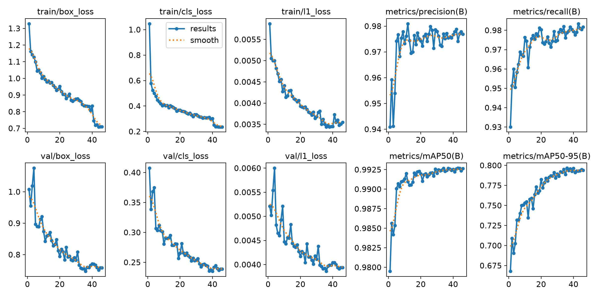

# 두 데이터셋 통합 상반신 탐지 · 실험 및 보고서 자료

실험 ID: `upper-body-unified-v2` · 학습 완료일: 2026-11-19 · 문서 정리일: 2026-11-22.
이 브랜치는 통합 실험을 보존한 `8cc0bc9`에서 분기했습니다. 새로운 학습 실행 결과가 아니라
당시 완료된 실험의 코드·정제 기준·집계 결과를 정리한 기록입니다.

원래 앱에서 사용한 **COCO 사전학습 YOLO26n**을 출발점으로, 두 강의실 데이터셋의
주석을 상반신 `0: person` 기준으로 정리해 함께 학습했습니다. 완료된 최종 실험은
`upper-body-unified-v2`입니다. 사람 탐지 학습이며 AIM-LTCC·BPBreID·얼굴 모델은
이번 실험에서 추가 학습하지 않았습니다.

## 데이터 출처와 정제

| 데이터 | 원본 | 사용 방식 | 통합본에 채택 |
|---|---:|---|---:|
| [reddy projects / classroom-dodzk v1](https://universe.roboflow.com/reddy-projects-zulke/classroom-dodzk/dataset/1) | 1,650장 | 클래스 이름 8·9의 상반신만 person으로 통합. 머리 중심에 대응하는 상반신이 없는 이미지 376장 제외 | 1,274장 |
| [buenos-dias / ClassRoom v1](https://app.roboflow.com/buenos-dias/classroom-o4dnp-k83mj/1) | 450장 | Student·with-student 주석을 시각 선별. 책상·여러 사람 포함 박스와 누락·중복을 확인해 일부 재표시, 불확실한 이미지 197장 제외 | 253장 |

두 데이터의 제공 메타데이터에 표시된 라이선스는 CC BY 4.0입니다. 첫 데이터의
숫자 클래스는 사람별 ID가 아니며, 8·9의 역할은 주석 샘플의 박스 범위를 확인한
해석입니다. 두 번째 데이터의 두 클래스를 그대로 person으로 일괄 변환하지 않았습니다.

기준은 **한 사람의 머리와 보이는 어깨·몸통을 감싸는 상반신 박스 하나**입니다.
얼굴 박스, 손·팔만 보이는 박스, 책상 전체, 여러 사람을 함께 감싸는 박스를 같은
person 정답으로 섞지 않습니다. 얼굴은 기존 YuNet/SFace 추론에서 ID 보조 정보로
사용합니다. 상세 기준과 검수 범위는 [주석 기준](ANNOTATION_POLICY.md)을 참고하세요.

| 분할 | 첫 데이터 | 두 번째 데이터 | 합계 | person 박스 |
|---|---:|---:|---:|---:|
| train | 764 | 176 | 940 | 11,635 |
| valid | 275 | 51 | 326 | 4,819 |
| test | 235 | 26 | 261 | 2,558 |
| 전체 | 1,274 | 253 | 1,527 | 19,012 |

원본 분할을 유지했습니다. 두 번째 데이터에는 사람이 없는 것을 확인한 배경 이미지
16장(train 11·valid 3·test 2)이 포함됩니다. 이미지 SHA-256의 정확한 중복은 없습니다.

**검수 범위:** 첫 데이터는 기존 정제본을 계승했고 이번 시각 재검수는 표본 12장입니다.
두 번째 데이터는 450장 시각 선별 후 일부를 직접 또는 모델 보조로 재표시했습니다.
두 데이터 전체를 새로 재주석한 독립 정답셋은 아닙니다. 같은 장소·인접 프레임이
분할 간에 나타나므로 실제 설치 장소의 일반화 성능과 구분해야 합니다.

## 학습 설정과 완료 결과

두 모델을 따로 학습한 뒤 가중치를 합친 것이 아니라, **정제한 두 데이터셋을 합쳐
원래 YOLO26n에서 하나의 모델을 학습**했습니다. 이전 person 파인튜닝 모델에
이어 학습한 실험도 아닙니다. 설정은 [학습 YAML](configs/upper-body-unified-v2-train.yaml)에 있습니다.

| 항목 | 실제 조건 |
|---|---|
| 출발 가중치 | 앱이 원래 사용하던 `yolo26n.pt` |
| 입력 크기 / 배치 | 640 / 4 |
| 최대 epochs / patience | 50 / 10 |
| 실제 완료 / 최적 검증 epoch | 46 epoch에서 조기 종료 / 검증 mAP50–95 기준 36 epoch |
| 최적 epoch의 검증 mAP50–95 | 79.66% (테스트 점수가 아님) |
| workers / seed | 2 / 42 |
| 장치 | NVIDIA RTX A2000, VRAM 약 6 GB |
| 환경 | Python 3.12.15, PyTorch 2.11.0+cu128, Ultralytics 8.4.202 |

## 원래 사용하던 모델과 비교

아래 **기존 모델은 사전학습 YOLO26n**입니다. 각 행의 기존·통합 모델은 **같은 정제
테스트 이미지·정답, 입력 640, batch 4, CUDA, 예측 클래스 0(person)**으로 평가했습니다.
수치는 비율의 백분율이며 mAP50–95는 IoU 0.50~0.95 평균입니다.

| 테스트 | 모델 | Precision | Recall | mAP50 | mAP50–95 |
|---|---|---:|---:|---:|---:|
| classroom-dodzk 235장 | 기존 YOLO26n | 85.48% | 53.81% | 71.15% | 50.89% |
| classroom-dodzk 235장 | **통합 파인튜닝** | **98.14%** | **98.86%** | **99.27%** | **84.13%** |
| ClassRoom 정제본 26장 | 기존 YOLO26n | 35.44% | 62.32% | 46.07% | 12.66% |
| ClassRoom 정제본 26장 | **통합 파인튜닝** | **100.00%** | **98.97%** | **99.50%** | **72.84%** |

- 첫 데이터: mAP50–95 **+33.24%p**, Recall **+45.05%p**.
- 새 정제 데이터: mAP50–95 **+60.18%p**, Recall **+36.66%p**.
- Precision 100%는 선별된 작은 테스트셋에서의 결과이며 오류 없는 시스템을 뜻하지 않습니다.
- 기존 모델은 일반 person 박스를, 정제 정답은 상반신을 대상으로 하므로 박스 범위 차이가
  특히 mAP50–95에 영향을 줍니다. 결과는 이 상반신 탐지 과제에 대한 적합도를 나타냅니다.

중간에 첫 데이터만 학습한 person 모델과도 비교했습니다. 첫 데이터의 mAP50–95는
84.58% → 84.13%로 0.45%p 감소했고, 새 정제 데이터는 10.37% → 72.84%로 62.47%p
증가했습니다. 통합 모델이 모든 조건에서 더 좋아졌다고 해석하지 않습니다.
전체 세 모델 비교는 [상세 결과](UNIFIED_TRAINING_RESULTS.md), 수치·환경·해시는
[JSON 요약](reports/unified-v2-20261119.json)에 보관합니다.

이 결과는 **이미지의 상반신 탐지** 평가입니다. 출석 정확도·IDF1·HOTA·재입장 복구율,
실시간 FPS 개선은 이번 학습으로 검증하지 않았습니다. 과거 ClassRoom 원본의 두 클래스
모델 평가도 정답 기준과 테스트 이미지가 달라 직접 비교할 수 없습니다.

## 제출용 실제 학습 로그

[학습 로그 모음](reports/unified-v2-logs/README.md)에 당시 콘솔 전체 출력, 실제 실행 인자,
원본 학습·검증 곡선과 공개본 변경 이력을 모았습니다. [46에포크 CSV](reports/unified-v2-training.csv)와
함께 학습 증빙으로 사용할 수 있습니다. 콘솔·설정의 로컬 경로만 치환했으며,
이번 문서 작업에서 재학습하지 않았습니다.



## 보고서에 사용할 수 있는 서술

아래 문장은 이번 통합 실험에 대한 것입니다. 전체 구성 데이터 1,527장을 모두 가중치
학습에 사용한 것으로 적지 않습니다. 실제 학습용 이미지는 940장입니다.

### Ⅰ. 분석 설정

> 기존 Classroom Vision의 사람 탐지기인 COCO 사전학습 YOLO26n을 강의실 상반신
> 탐지에 맞게 파인튜닝하였다. classroom-dodzk v1 원본 1,650장 중 1,274장과
> ClassRoom v1 원본 450장 중 시각 검수로 채택한 253장을 사용하여, 전체 1,527장과
> 19,012개의 person 박스로 구성된 통합 데이터셋을 만들었다. 한 사람의 머리와 보이는
> 어깨·몸통을 감싸는 상반신 박스 하나를 단일 클래스 `person`으로 정의하였다.
> 첫 데이터의 기존 상반신 정제본을 계승하고, 두 번째 데이터의 일부 주석은 직접 또는
> 모델 보조 검수로 수정했으며 불확실한 이미지는 제외하였다. 첫 데이터의 이번 시각
> 재검수는 12장 표본이므로 두 데이터 전체를 새로 재주석한 것은 아니다.

> 원본 분할을 유지하여 학습 940장(61.56%), 검증 326장(21.35%), 테스트 261장(17.09%)으로
> 나누었다. 사전학습 YOLO26n에서 입력 크기 640, batch 4, seed 42, 최대 50에포크,
> patience 10으로 학습하였다. 46에포크에서 조기 종료하였으며, 검증 mAP50–95가 가장
> 높은 36에포크의 가중치를 최종 평가에 사용하였다. 이때 검증 mAP50–95는 79.66%였다.
> 테스트는 가중치 학습과 최적 체크포인트 선택에 사용하지 않았다.

주 지표는 mAP50–95이며 Precision, Recall, mAP50도 함께 제시합니다. mAP는 해당
검출 과제의 지표이며 사람 수 정답률이나 출석 정확도와 같은 뜻이 아닙니다.
원본 데이터의 분할 설계와 모델 보조 정제에 따른 한계는 아래에 함께 기재합니다.

### Ⅱ. 모델 비교와 최종 선택

위의 기존 YOLO26n 대 통합 파인튜닝 표를 사용합니다. 서로 다른 출처를 섞은 평균을
새로 만들지 않고, 첫 출처 테스트 235장과 두 번째 출처 테스트 26장을 각각 보고합니다.
기존 모델은 첫 데이터만 파인튜닝한 중간 모델이 아닌 COCO 사전학습 YOLO26n입니다.

최종 모델은 검증 지표로 선택한 통합 모델 `best.pt`입니다. 기준은 **검증 손실의 합이
아니라 검증 mAP50–95**입니다. 학습·검증 기록은
[실제 46에포크 CSV](reports/unified-v2-training.csv), 출처별 테스트 결과와 가중치 해시는
[실험 요약 JSON](reports/unified-v2-20261119.json)에 보관했습니다.

세 모델 중 통합 모델이 모든 테스트에서 최고인 것은 아닙니다. 첫 데이터 전용 모델은
첫 출처에서 mAP50–95가 0.45%p 높고, 통합 모델은 두 번째 출처에서 62.47%p 높았습니다.
통합 모델은 두 출처에 대한 상반신 탐지 적용 범위를 확인하는 실험 결과로 설명합니다.

### Ⅲ. 핵심 그래프에 넣을 값

백분율 단위의 아래 값으로 기존 모델과 통합 모델을 비교하는 출처별 막대그래프를
만들 수 있습니다. 두 테스트의 이미지 수와 출처 이름을 제목이나 캡션에 표시합니다.

| 지표 | 첫 출처 기존 | 첫 출처 통합 | 두 번째 출처 기존 | 두 번째 출처 통합 |
|---|---:|---:|---:|---:|
| Precision (%) | 85.48 | 98.14 | 35.44 | 100.00 |
| Recall (%) | 53.81 | 98.86 | 62.32 | 98.97 |
| mAP50 (%) | 71.15 | 99.27 | 46.07 | 99.50 |
| mAP50–95 (%) | 50.89 | 84.13 | 12.66 | 72.84 |

캡션 예시: “같은 정제 테스트에서 기존 YOLO26n과 통합 파인튜닝 모델을 비교하였다.
첫 출처 235장과 두 번째 출처 26장에서 mAP50–95가 각각 33.24%p, 60.18%p 증가하였다.”
원본 소수값은 요약 JSON을 사용하며, 반올림한 그래프 값을 다시 평균하지 않습니다.

### Ⅳ. 해석 3문장

> 두 데이터셋을 상반신 person 기준으로 정리해 함께 학습한 모델은 기존 YOLO26n 대비
> 첫 출처 테스트 235장에서 mAP50–95가 50.89%에서 84.13%로 33.24%p, 두 번째 출처
> 테스트 26장에서는 12.66%에서 72.84%로 60.18%p 높아졌다.
> 같은 테스트의 Recall도 각각 53.81%에서 98.86%, 62.32%에서 98.97%로 높아져,
> 이 정제 데이터의 상반신 정답 기준에서 탐지 누락이 감소하였다.
> 다만 분할 간 동일 장소·인접 프레임과 모델 보조 주석 검수의 영향이 있으며, 실제
> 강의실 영상의 인원 집계·출석 정확도와 ID 유지 성능은 별도 평가가 필요하다.

### Ⅴ. 함정 체크에 쓸 수 있는 근거

| 확인 항목 | 이번 실험에서 확인한 범위 |
|---|---|
| 정확도 한 숫자만 보고 판단했는가 | mAP50–95, Precision, Recall, mAP50을 출처별로 함께 비교했다. |
| 이미지·정답·평가 조건이 같은가 | 출처별 동일 정제 테스트, 입력 640, batch 4, CUDA, 예측 클래스 0으로 비교했다. |
| 동일 이미지 중복이 있는가 | 통합본의 SHA-256 기준 정확한 이미지 중복은 없었다. |
| 동일 인물·세션이 분할 간 독립인가 | 독립성을 확인하지 못했다. 이미지 중복 0건으로 인물·세션 독립성을 주장하지 않는다. |
| 검증으로 가중치를 선택했는가 | 검증 mAP50–95가 가장 높은 36에포크를 선택했다. 테스트 점수로 체크포인트를 선택하지 않았다. |
| 두 원본 클래스를 단순 병합했는가 | 두 번째 원본을 시각 선별·부분 재주석해 사람별 상반신 기준으로 정리했다. |
| 모든 주석이 독립 검수된 정답인가 | 아니다. 첫 정제본 계승·12장 표본 확인, 두 번째 데이터의 모델 보조 검수를 포함한다. |
| 추적·출석 성능까지 검증했는가 | 아니다. 이번 결과는 정지 이미지의 상반신 박스 탐지 평가다. |

### Ⅵ. 한계와 개선 방향

| 한계 | 후속 평가·개선 |
|---|---|
| 같은 장소·인접 프레임이 여러 분할에 포함된다. | 촬영 세션·인물별 분할과 새로운 강의실 테스트를 구성한다. |
| 두 번째 테스트가 선별된 26장으로 작다. | 제외 사례를 독립적으로 재주석하고 더 넓은 조건에서 평가한다. |
| 모델 보조 주석과 첫 데이터의 기존 주석을 사용했다. | 별도 검수자가 독립적으로 정답을 제작·검토한다. |
| 기존 모델의 일반 person 박스와 상반신 정답의 범위가 다르다. | 동일한 주석 정책에서 박스·인원 집계 오류를 함께 분석한다. |
| 이미지 탐지 결과만 있다. | 정답 ID 영상에서 IDF1, HOTA, ID 전환, 재입장 복구율을 측정한다. |
| 앱에 통합 모델을 연결한 실시간 비교가 없다. | 동일 영상·장치에서 탐지기 교체 전후 전체 처리 FPS와 ID 성능을 비교한다. |

### Ⅶ. 작업 내용과 근거

수행한 작업은 원본 검사와 보존, 상반신 주석 기준 정리, 첫 데이터 정제, 두 번째 데이터
450장 시각 선별·부분 재표시, 두 정제본 통합, 사전학습 YOLO26n 파인튜닝, 세 모델의
출처별 테스트 평가, 가중치·데이터·검수 원장의 SHA-256 기록입니다. 준비 코드에는
누락 라벨·잘못된 박스·중복 이미지·미검수 후보를 거부하고 기존 출력을 보호하는
검사를 넣었으며 단위 테스트 18개를 통과했습니다.

보고서의 AI 작업 로그에는 “Codex로 준비·학습·평가 코드와 문서 작성을 수행하고,
Python/Ultralytics의 실제 실행 기록과 설정·지표·해시를 대조했다”라고 기록할 수 있습니다.
팀원이 실제로 확인한 범위는 별도로 적어야 합니다. 이 통합 실험의 공개 근거는 아래
CSV·JSON이며, MLflow 기록을 근거로 제시하는 실험은 아닙니다.

- 학습·검증 곡선과 최적 에포크: [실제 CSV](reports/unified-v2-training.csv)
- 테스트 수치·실행 설정·해시: [집계 JSON](reports/unified-v2-20261119.json)
- 정제 기준·검수 범위: [주석 정책](ANNOTATION_POLICY.md)
- 세 모델 비교: [상세 결과](UNIFIED_TRAINING_RESULTS.md)
- 실행 방법·공개되지 않은 자료의 필요성: 아래 재현 절차

## 파일 구조와 데이터 준비

```text
fine_tuning/
  ANNOTATION_POLICY.md        # 주석 기준과 검수 범위
  UNIFIED_TRAINING_RESULTS.md # 세 모델 비교
  configs/                   # 데이터 경로와 학습 설정
  reports/                   # 공개 가능한 집계 지표·설정·해시
  yolo/                      # 준비·학습·평가 코드
  tests/                     # 데이터 준비 보호 장치 테스트
  data/                      # 원본·정제본·검수 원장 (Git 제외)
  checkpoints/               # 가중치 (Git 제외)
  runs/                      # 학습 로그·평가·실행 설정 (Git 제외)
```

저장소에는 데이터셋, 식별 가능한 이미지·영상, 이미지별 검수 원장, 모델 가중치,
API 키를 포함하지 않습니다. 내려받은 원본과 검수 자료는 별도로 준비해야 합니다.
검수 원장은 `data/upper-body-unified-v1-review/decisions.json`에 두며, 실행기는 원본
450장에 대해 누락·중복 없는 명시적 채택/제외 결정과 채택 박스를 요구합니다.
**원본 ZIP만으로는 이번 사람이 확인한 정제본을 완전히 재생성할 수 없습니다.**
동일 실험 재현에는 보관 중인 검수 원장이 필요합니다. 요약 JSON의 manifest·원장
해시로 같은 정제본인지 확인하세요. 검수 원장이 없으면 주석 기준에 따라 새 원장을
만들고 별도 실험으로 평가해야 합니다.

학습 전용 환경은 기존 추적 환경의 Python을 재사용하거나 다음처럼 준비합니다.
GPU용 PyTorch는 장치에 맞는 버전을 별도로 설치합니다.

```sh
python3.12 -m venv .venv
.venv/bin/python -m pip install -r fine_tuning/requirements.txt
```

로컬 자료 위치:

```text
fine_tuning/data/roboflow-classroom-dodzk/raw/
fine_tuning/data/roboflow-classroom-dodzk/person/
fine_tuning/data/shared-classroom-v1/raw/
fine_tuning/data/upper-body-unified-v1-review/decisions.json
fine_tuning/data/upper-body-unified-v2/
~/.cache/aix-classroom-tracking/yolo26n.pt
```

실행기는 데이터와 가중치를 자동 다운로드하지 않습니다.

## 준비 → 검사 → 학습 → 출처별 평가

아래는 프로젝트 루트에서 실행합니다. 기존 정제본·완료 실험을 보존하므로 준비나
실험 출력이 이미 있으면 새 출력 경로·이름을 사용하세요.

```sh
# 첫 데이터의 기존 상반신 정제 (이미 있으면 실행 생략)
.venv/bin/python fine_tuning/yolo/prepare_classroom_dodzk.py

# 두 원본과 별도 보관된 검수 원장으로 통합본 생성
.venv/bin/python fine_tuning/yolo/prepare_unified_classroom.py

# 모델을 로딩하거나 학습을 시작하지 않는 데이터 사전 검사
.venv/bin/python fine_tuning/yolo/run.py train \
  --config configs/upper-body-unified-v2-train.yaml --device 0 --check

# 학습과 세 모델의 출처별 테스트 비교
.venv/bin/python -u fine_tuning/yolo/train_unified_classroom.py
```

비교 실행기는 첫 person 모델이 아래 위치에 있을 것을 요구합니다.
그 모델도 없다면 첫 정제본으로 먼저 생성합니다.

```sh
.venv/bin/python fine_tuning/yolo/run.py train \
  --config configs/classroom-dodzk-train.yaml --device 0
```

- 첫 person 모델: `fine_tuning/runs/yolo/classroom-dodzk-person/weights/best.pt`
- 통합 원본 결과: `fine_tuning/runs/yolo/upper-body-unified-v2/weights/best.pt`
- 통합 복사본: `fine_tuning/checkpoints/upper-body-unified-v2-best.pt`
- 상태·출처별 지표: `fine_tuning/runs/upper-body-unified-v2-20261119/status.json`
- 실제 학습 인자: `fine_tuning/runs/yolo/upper-body-unified-v2/args.yaml`

원래 분리 실험인 `yolo/train_shared_classroom.py`는 원본의 Student·with-student
두 클래스를 유지한 모델을 만듭니다. 현재 통합 person 모델을 재현하는 명령이 아닙니다.
해당 원본 실험에는 `fine_tuning/data/shared-classroom-v1/ClassRoom.v1i.yolo26.zip`도 필요합니다.

## 검증과 앱 적용 상태

```sh
.venv/bin/python -m unittest discover -s fine_tuning/tests -v
```

18개 테스트를 통과했습니다. 잘못된 주석·누락 라벨·중복 이미지·미검수 후보의 반영을
거부하고, 제외 이미지를 배경으로 바꾸지 않으며, 기존 출력과 원본을 보존하는지 검사합니다.

학습한 모델은 현재 앱의 기본 가중치를 자동 교체하지 않습니다. 기존 캐시를 덮어쓰지
마세요. 이 브랜치는 학습·정제·평가와 기록을 추가하며, 실제 앱 연결 및 정답 영상의
ID 유지 검증은 별도 작업입니다.

통합 가중치 SHA-256:
`857c7d671b47292bf81bcae961d230f1b7913dc5894abdef8e626ddabff0edf2`
