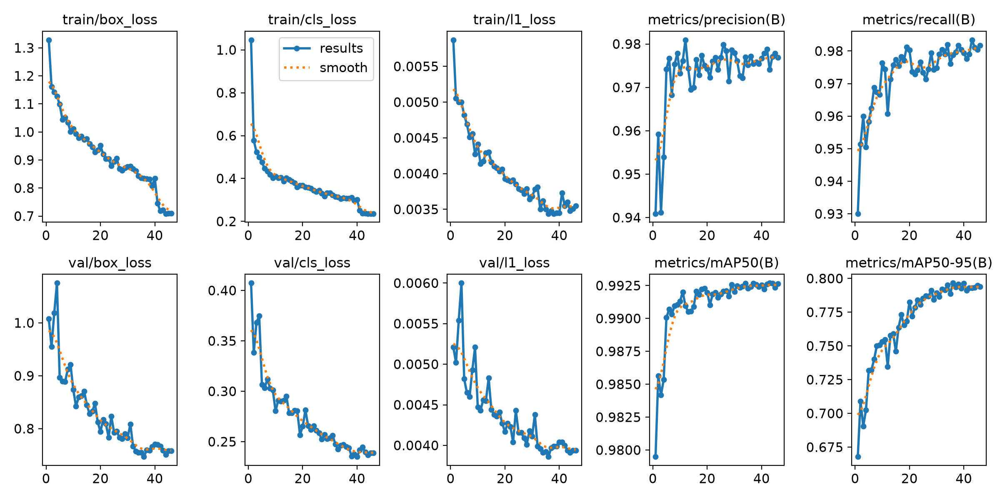

# 두 데이터셋 통합 실험 학습 로그

2026-11-19에 실행한 `upper-body-unified-v2`의 실제 기록입니다. 로그 제출을 위해
학습을 다시 실행하거나 결과를 재구성하지 않았습니다.

| 파일 | 용도 |
|---|---|
| [console.txt](console.txt) | 당시 컨트롤러가 저장한 콘솔 출력. 모델·환경·학습 진행·검증·조기 종료·세 모델의 출처별 테스트 평가 포함 |
| [에포크별 CSV](../unified-v2-training.csv) | 1~46에포크의 train/val 손실, 검증 Precision·Recall·mAP, 학습률, 누적 시간 |
| [args.yaml](args.yaml) | Ultralytics가 저장한 실제 실행 인자. 로컬 경로만 공개용으로 치환 |
| [results.png](results.png) | 당시 Ultralytics가 생성한 학습·검증 곡선 원본 |
| [provenance.json](provenance.json) | 원본·공개본 SHA-256과 공개용 변경 내역 |
| [테스트 결과 JSON](../unified-v2-20261119.json) | 출처별 동일 테스트의 기존 모델·첫 person 모델·통합 모델 지표 |

## 로그에서 확인할 내용

- 시작 설정: `imgsz=640`, `batch=4`, `epochs=50`, `patience=10`, `seed=42`, CUDA RTX A2000.
- 학습 데이터 940장, 검증 데이터 326장. 테스트는 학습 이후 출처별로 별도 실행했습니다.
- `EarlyStopping: Training stopped early` 줄: 최적 36에포크, 이후 10에포크 동안 개선 없음.
- `46 epochs completed` 줄: 실제 완료한 에포크 수.
- CSV의 36에포크 `metrics/mAP50-95(B)=0.7966`: 학습 중 검증 점수 79.66%.
- `EXPERIMENT_COMPLETE` 줄: 세 모델의 출처별 테스트 평가가 완료된 집계 값.

CSV와 results.png의 metrics는 **학습 중 검증셋 지표**입니다. 출처별 테스트 84.13%·72.84%와
혼동하지 않습니다. 검증 손실 합이 아니라 검증 mAP50–95로 최적 가중치를 선택했습니다.
콘솔에는 표시 자리수에 따른 반올림이 있으며 정밀한 테스트 수치는 JSON을 사용합니다.

## 공개본의 변경과 재현

콘솔은 ANSI 제어문자와 줄 끝 공백을 제거하고 줄바꿈을 LF로 정리했으며, 로컬 프로젝트 경로를
`<PROJECT_ROOT>/`, 사용자 캐시 경로를 `<USER_CACHE>/`로 치환했습니다. 진행률 출력은
그대로 남겨 반복되는 줄이 있습니다. 실행 인자도 같은 경로 치환만 했습니다.
이 경로 표기는 실제 실행 전에 자신의 환경 경로로 바꿔야 합니다.
CSV와 곡선 PNG는 원본 파일과 바이트 단위로 동일합니다.

원본 로그·설정은 서버에 보존했습니다. 공개용 수정 때문에 콘솔·설정의 해시가 달라지는
사항을 provenance.json에 기록했습니다. 데이터 이미지·배치 예시·가중치는 포함하지 않습니다.
보고서 서술과 실행 방법은 [상위 README](../../README.md)를 참고하세요.
